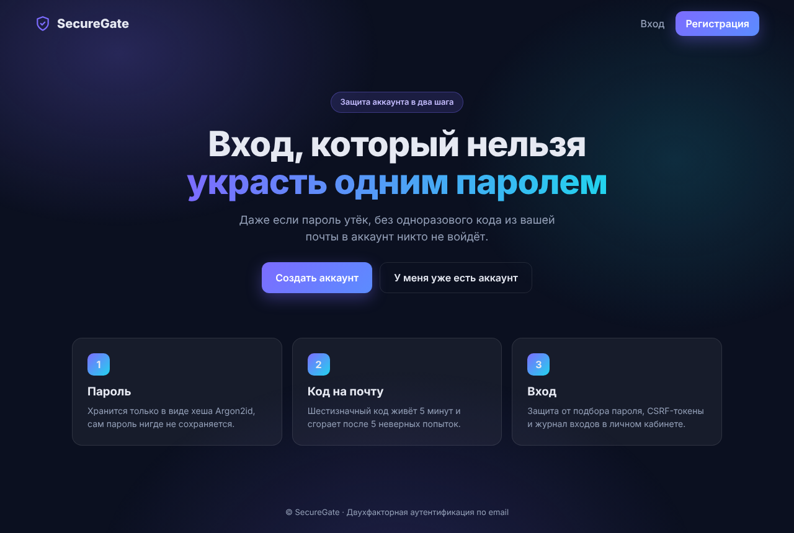
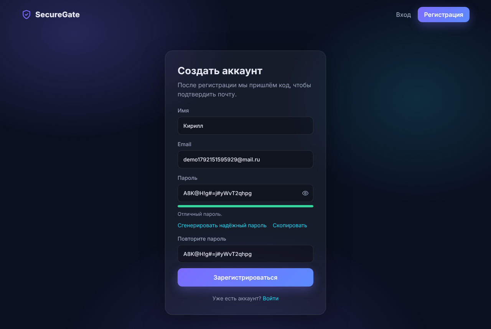
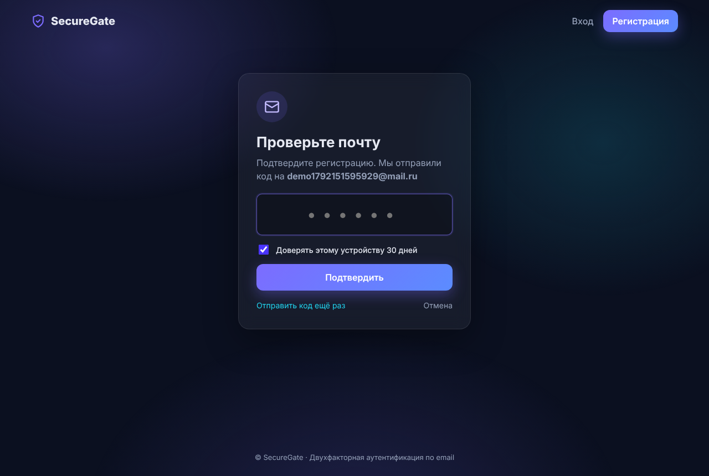
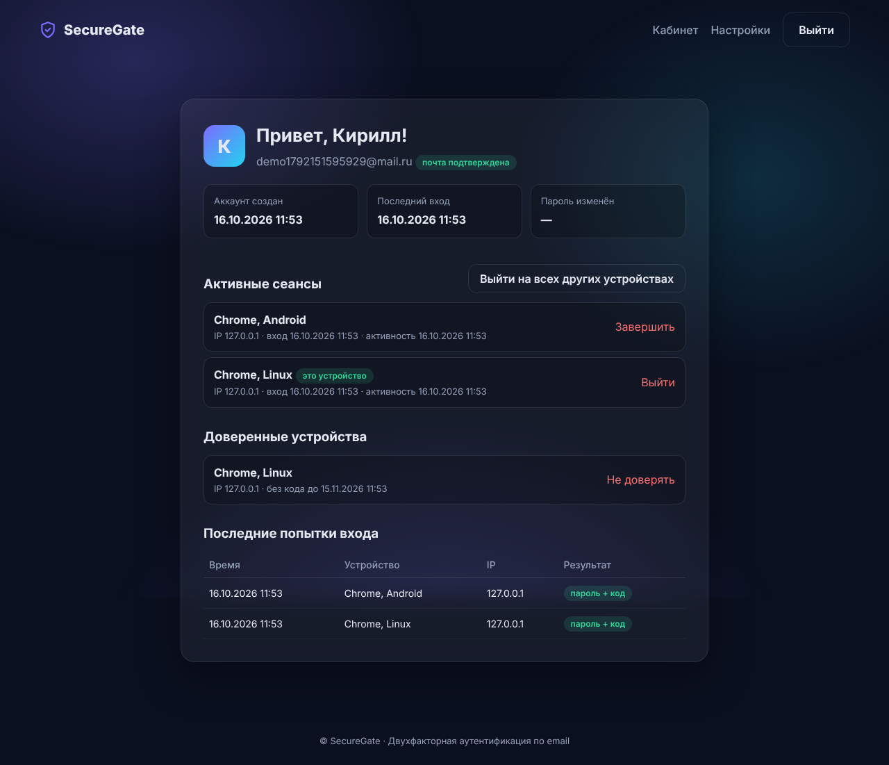
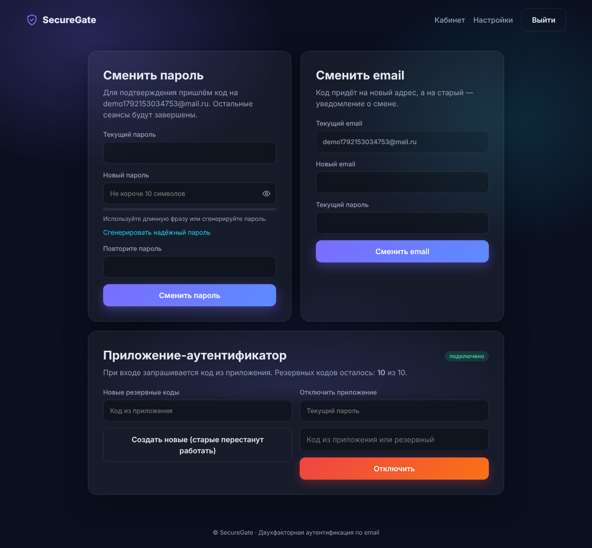
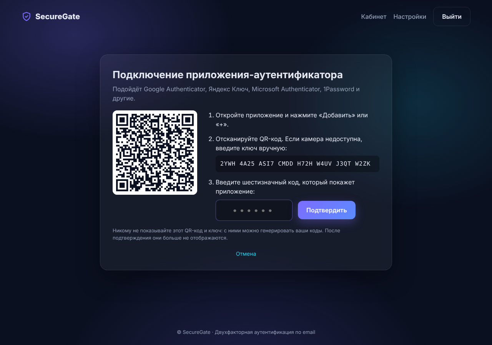
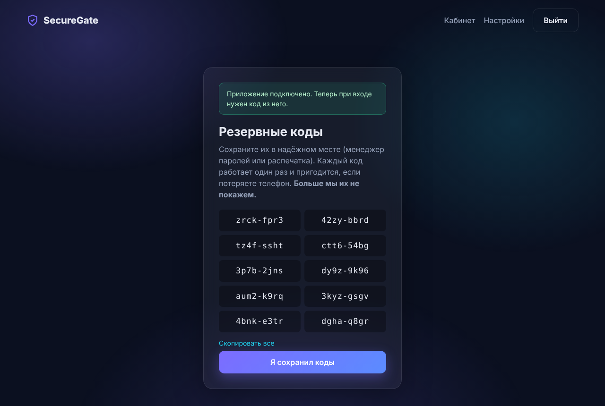

# SecureGate — двухфакторная аутентификация

[](https://github.com/ShishaKirich/2fa-auth-site/actions/workflows/ci.yml)

Веб-приложение с регистрацией и входом в два шага: пароль плюс одноразовый код из письма или из приложения-аутентификатора (Google Authenticator, Яндекс Ключ). Кроме этого есть восстановление пароля, доверенные устройства, контроль активных сеансов и уведомления о входе. Все меры защиты описаны в [SECURITY.md](SECURITY.md).



| Регистрация с генератором пароля | Ввод кода |
|---|---|
|  |  |

| Личный кабинет: сеансы и устройства | Настройки |
|---|---|
|  |  |

| Подключение приложения-аутентификатора | Резервные коды |
|---|---|
|  |  |

## Место в портфолио

Это промежуточный проект. В нём отработан механизм аутентификации, который затем перейдёт в мой мессенджер [grpc-messenger](https://github.com/ShishaKirich/grpc-messenger):

- вход в два шага: код на почту и приложение-аутентификатор (TOTP) с резервными кодами;
- серверные сеансы с отзывом, доверенные устройства и уведомления о входе с нового устройства;
- защита от подбора, перебора аккаунтов и повторного использования кодов;
- проверка паролей по стойкости и базе утечек.

Решения намеренно собраны в отдельные модули (`sessions.py`, `otp.py`, `totp.py`, `passwords.py`, `security.py`), чтобы их можно было перенести в другой проект.

## Возможности

- **Регистрация** с подтверждением почты кодом.
- **Вход в два шага**: пароль, затем код из письма.
- **Приложение-аутентификатор (TOTP)**: подключение по QR-коду, 10 резервных кодов на случай потери телефона. После подключения код из приложения заменяет код из письма, в том числе при восстановлении пароля.
- **Восстановление пароля** по коду. Все остальные сеансы при этом завершаются.
- **Смена пароля и email** в настройках, с подтверждением кодом. При смене email код приходит на новый адрес, а старому отправляется уведомление.
- **Доверенные устройства**: можно не вводить код 30 дней. Доверие отзывается из кабинета и автоматически при смене пароля.
- **Уведомление о входе с нового устройства** на почту.
- **Активные сеансы**: список устройств и кнопка «Выйти на всех других устройствах».
- **Проверка пароля** по стойкости (zxcvbn) и по базе утечек Have I Been Pwned.
- **Генератор паролей** в браузере на `crypto.getRandomValues`, с индикатором надёжности.

## Безопасность в двух словах

Argon2id для паролей, HMAC для кодов, TOTP с зашифрованным секретом и защитой от повтора кода, серверные сеансы с хешированными токенами, лимиты на попытки и на отправку кодов, защита от перебора аккаунтов, CSRF-токены, строгий CSP и заголовки безопасности. Модель угроз и известные ограничения описаны в [SECURITY.md](SECURITY.md).

## Производительность

Асинхронный сервер (FastAPI + Uvicorn) в нескольких процессах, SQLite в режиме WAL с автокоммитом, так что запись не блокирует чтение. Тяжёлые вычисления (Argon2, zxcvbn) вынесены в отдельные потоки.

Нагрузочный тест на 4 vCPU (4 воркера, клиент на той же машине): **300 пользователей одновременно** прошли полный сценарий «регистрация → код → выход → вход → код», 2100 запросов, 0 ошибок. При 50 одновременных пользователях медианное время ответа около 130 мс.

## Стек

Python 3.10+, FastAPI, Uvicorn, SQLite (aiosqlite, чистый SQL), Argon2, pyotp, segno, cryptography, zxcvbn, httpx, aiosmtplib, Jinja2, HTML/CSS/JS без фреймворков, pytest.

## Структура

```
app/
  main.py       маршруты: регистрация, вход, коды, восстановление, кабинет, настройки
  sessions.py   серверные сеансы и устройства
  otp.py        выдача и проверка одноразовых кодов из писем
  totp.py       приложение-аутентификатор: секрет, QR-код, проверка, резервные коды
  passwords.py  проверка пароля: zxcvbn и база утечек HIBP
  security.py   Argon2, генерация кодов и токенов, CSRF
  mailer.py     письма: коды и уведомления (SMTP или вывод в консоль)
  db.py         подключение к SQLite
  schema.sql    таблицы users, otp_codes, backup_codes, sessions, devices, login_events
  config.py     настройки из .env
  templates/    HTML-страницы
  static/       стили и app.js (генератор паролей, индикатор надёжности)
tests/          37 автотестов: сценарии и меры защиты
docs/           путеводитель по коду и скриншоты
```

## Запуск

**Windows, проще всего:** дважды щёлкните `run.bat`. Он создаст окружение, установит зависимости, создаст `.env` со случайным ключом и откроет сайт в браузере.

**Вручную:**

```bash
python -m venv .venv
source .venv/bin/activate          # Windows: .venv\Scripts\activate
pip install -r requirements.txt
cp .env.example .env               # Windows: copy .env.example .env
uvicorn app.main:app --reload      # http://localhost:8000
```

По умолчанию `MAIL_BACKEND=console`: письма не отправляются, а коды и уведомления печатаются в терминал. Это удобно для разработки.

Боевой режим с несколькими процессами:

```bash
uvicorn app.main:app --host 0.0.0.0 --port 8000 --workers 4
```

База из предыдущих версий обновляется автоматически при запуске: недостающие колонки добавляются, пользователи сохраняются.

## Подключение почты (Gmail)

1. Заведите отдельный ящик Gmail для сайта (личный лучше не использовать).
2. Включите двухэтапную проверку: Аккаунт Google → Безопасность.
3. Создайте пароль приложения: https://myaccount.google.com/apppasswords (16 символов).
4. Заполните `.env`:

```
SECRET_KEY=<python -c "import secrets; print(secrets.token_urlsafe(48))">
MAIL_BACKEND=smtp
SMTP_HOST=smtp.gmail.com
SMTP_PORT=587
SMTP_USERNAME=site.address@gmail.com
SMTP_PASSWORD=пароль_приложения
SMTP_FROM=site.address@gmail.com
```

Яндекс и Mail.ru настраиваются так же (у них тоже есть пароли приложений): `smtp.yandex.ru:465`, `smtp.mail.ru:465`.
Если писем станет много, лучше взять транзакционный сервис (Brevo, Mailgun, Resend, Unisender Go). Они дают SMTP-доступ, поэтому поменять придётся только `.env`.

## Тесты и проверки

```bash
pip install -r requirements-dev.txt
pytest -q                    # 37 тестов
bandit -r app                # статический анализ безопасности
pip-audit -r requirements.txt  # уязвимости в зависимостях
```
